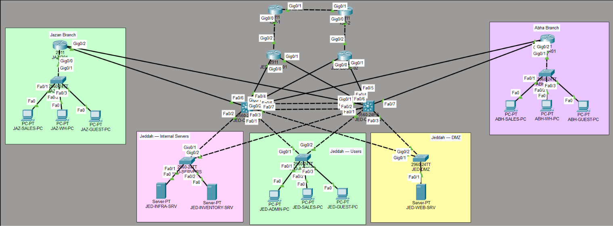

# Multi-Site Enterprise Network Design & Security Lab

**Cisco Packet Tracer • Jeddah HQ / Jazan / Abha • Personal hands-on networking project**  
**Author:** Hussein Abdullah Ali Al-Mansb • Cisco CCNA Certified



## Project overview

A simulated enterprise network linking a redundant headquarters network in Jeddah to branches in Jazan and Abha. I built the topology and configured switching, routing, network services, resilience, and access controls to practice real-world network operations and troubleshooting.

The Cisco Packet Tracer project file is available as **[`multi-site-enterprise-network-lab.pkt`](multi-site-enterprise-network-lab.pkt)**. It has been included as submitted; the `.pkt` file itself has not been executed or independently validated outside Packet Tracer.

## Technologies

- **Switching:** VLANs, 802.1Q trunks, Inter-VLAN Routing, LACP EtherChannel, Rapid PVST+
- **Routing:** OSPF and redundant routing paths between sites
- **Gateway redundancy:** HSRP on headquarters VLANs
- **Network services:** DHCP, DHCP relay, DNS, NAT/PAT
- **Security:** SSH administration with VTY ACL, guest ACL rules, Port Security (sticky MAC), DHCP Snooping
- **Segmentation:** Admin, Sales, Guest, Servers, DMZ, and Management networks

**Verification limits:** A forced HSRP failover test was not supplied. The guest inbound ACL attachment to VLAN 40 was not conclusively verified; the CLI showed `Inbound access list is not set` during troubleshooting, so guest ACL enforcement is not presented as fully validated.

## Evidence: tests and outputs

| Topic | Observed result | Evidence |
|---|---|---|
| **Jazan OSPF** | Two neighbors in `FULL/BDR`; OSPF routes learned over two next hops | [Neighbor state](screenshots/ospf-jazan-neighbors.png) / [Routes](screenshots/ospf-jazan-routes-1.png) |
| **Jazan → HQ** | Ping from JAZ-SALES-PC to `10.10.50.10`: **4/4 replies, 0% loss** | [Ping](screenshots/jazan-to-jeddah-ping.png) |
| **Abha OSPF** | Two neighbors in `FULL/BDR`; OSPF route entries and default route displayed | [Neighbor state](screenshots/ospf-abha-neighbors.png) / [Routes](screenshots/ospf-abha-routes-1.png) |
| **Abha → HQ** | Ping from ABH-SALES-PC to `10.10.50.10`: **4/4 replies, 0% loss** | [Ping](screenshots/abha-to-jeddah-ping.png) |
| **NAT/PAT** | ICMP from `10.10.10.100` translated to `203.0.113.2` toward `192.0.2.1`, with 6 translation entries and non-zero hits | [NAT translations](screenshots/nat-pat-translations.png) |
| **DHCP Snooping** | Three binding entries on JED-ACCESS for VLANs 10, 20, 40 | [Binding table](screenshots/jeddah-dhcp-snooping-port-security-1.png) |
| **Port Security** | JED-ACCESS Fa0/1 and Fa0/2 `Secure-up`, sticky MAC, `Restrict`, 0 violations in displayed output | [Port-security outputs](screenshots/jeddah-dhcp-snooping-port-security-2.png) |
| **HSRP state** | Core-01 Active for VLANs 10,20,99; Core-02 Active for VLANs 40,50,60, with complementary standby roles | [Core-01](screenshots/hsrp-core01-current.png) / [Core-02](screenshots/hsrp-core02-current.png) |
| **VLANs/trunks** | Headquarters VLAN IDs and allowed trunk lists captured from core devices | [VLANs](screenshots/core01-vlan-table.png) / [Trunk](screenshots/core01-trunking.png) |
| **SSH access** | `SSH-ADMIN` ACL attached to VTY via `access-class`; `transport input ssh` | [Configuration](screenshots/acl-ssh-configuration.png) |

The **guest ACL** is shown in [the ACL list](screenshots/acl-guest-rules.png) and [guest traffic tests](screenshots/guest-traffic-test.png), but its active attachment to VLAN 40 was not confirmed; see [Verification Notes](docs/verification-checklist.md).

## Network overview and addressing

- **Jeddah HQ:** dual core switches, redundant edge routers, user access, internal servers, and DMZ
- **Jazan / Abha:** branch routers, access switches, Sales, Warehouse, and Guest networks
- **HQ DNS / infrastructure server:** `10.10.50.10` (lab address)

See [Addressing & VLANs](docs/addressing-and-vlans.md). Some branch gateway details remain undocumented rather than guessed.

## Repository contents

```text
multi-site-enterprise-network-lab.pkt
README.md
docs/
  addressing-and-vlans.md
  verification-checklist.md
screenshots/
  topology-final.png
  [routing, NAT, security, HSRP and VLAN evidence screenshots]
```

## How to use

1. Install and open Cisco Packet Tracer.
2. Open `multi-site-enterprise-network-lab.pkt`.
3. Inspect the configuration on each router and switch. Re-run the commands and connectivity checks in [Verification Notes](docs/verification-checklist.md).

**Disclaimer:** Educational lab only, not a deployed production network. Remove any non-lab credentials and sensitive configuration before publishing a project file publicly.
